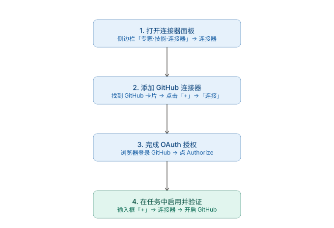

# GitHub 连接器使用流程

在 WorkBuddy 中使用 GitHub 连接器的完整流程，分四步：

1. **打开连接器面板**：左侧边栏点击「专家·技能·连接器」→ 切换到「连接器」页签。
2. **添加 GitHub 连接器**：找到 GitHub 卡片，点击右上角「+」→「连接」。
3. **完成 OAuth 授权**：浏览器打开 GitHub 授权页，登录并点击 Authorize；无需手动创建 Personal Access Token。
4. **在任务中启用并验证**：输入框左下角「+」→「连接器」→ 开启 GitHub；卡片出现绿色圆点即连接成功。

## 在任务中使用

- 连接器管理页点击 GitHub 卡片右侧「去对话」，直接进入对话。
- 新建任务时通过输入框「+」→「连接器」启用。
- 任务执行中若需要 GitHub，会出现连接引导卡片，点击授权后任务自动继续。

示例指令：

- 列出我的公开仓库，按更新时间排序
- 读取某仓库的结构，解释它是怎么实现的
- 查看某个 PR 的改动，帮我写 review 意见

## 管理

- 授权失效时，点击输入框上方的「重新连接」卡片即可恢复并自动重试。
- 临时停用：输入框「+」→「连接器」，关闭 GitHub 开关。
- 彻底解绑：连接器管理页选中 GitHub 卡片 →「解绑」。
- 也支持对话式管理，例如「重新连接 GitHub」「我安装了哪些连接器」。

## 注意

- 每个连接器独立授权；OAuth Token 可能过期，以实际拉一次数据成功为准。
- 连接器读写本身不消耗积分，但对外部数据的理解、汇总会消耗积分。
- 涉及创建 Issue、提交代码等写操作前，请确认目标仓库和内容。

官方文档：https://www.workbuddy.cn/docs/workbuddy/From-Beginner-to-Expert-Guide/Function-Description/Connector
